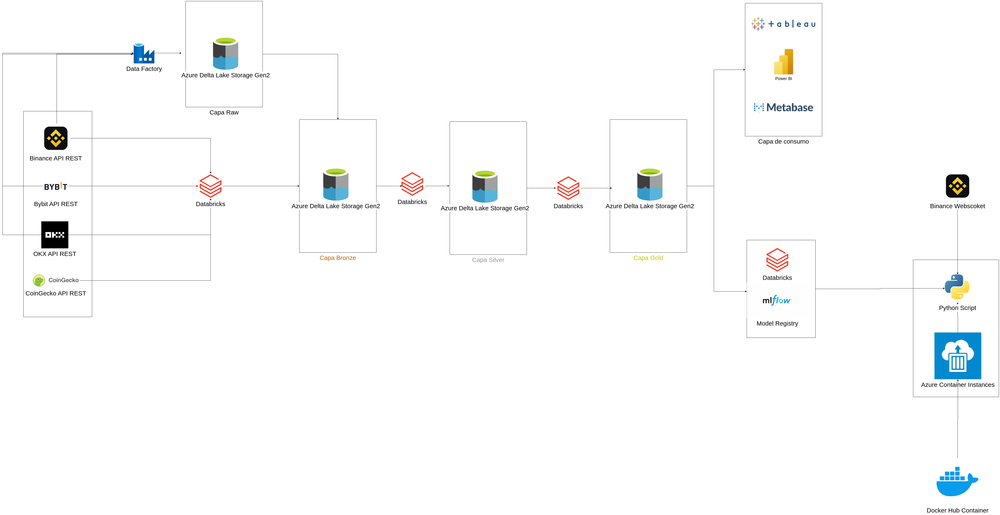
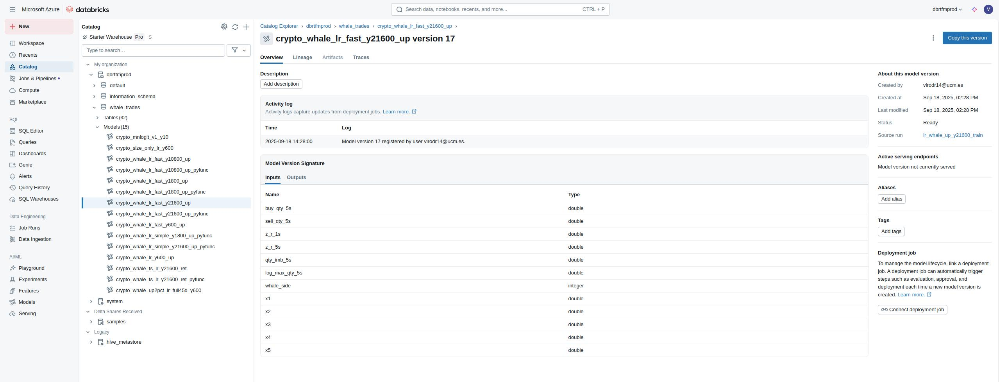

# Arquitectura de Análisis y Trading Predictivo en Mercados de Futuros de Criptomonedas

Master's thesis (Big Data & Data Engineering, UCM): an end-to-end real-time data pipeline on Microsoft Azure that analyzes price variability in crypto futures markets, detects "whale trades" (large-volume operations) and predicts short-term price increases.

## Resumen

- Procesa y transforma la información en **Azure Databricks** desde **Binance API, OKX API y Bybit API**.
- Aplica arquitectura **Medallion (raw, bronze, silver, gold)** para almacenamiento en **Azure Data Lake Storage Gen2**.
- Entrena y registra modelos en **MLflow**, integrados con **Unity Catalog**.
- Despliega un prototipo en **Azure Container Instances (ACI)** que consume el WebSocket de Binance y realiza predicciones en tiempo real.

## Arquitectura



**Componentes principales:**
- **Fuentes de datos**: Binance (REST/WebSocket), Bybit y OKX.
- **Almacenamiento**: ADLS Gen2 con arquitectura Medallion (raw → bronze → silver → gold).
- **Ingesta/Orquestación**: Azure Data Factory + Azure Databricks.
- **Procesamiento**: Azure Databricks.
- **Gobierno**: Unity Catalog para trazabilidad y control de accesos.
- **Despliegue**: Docker + Azure Container Instances (ACI).
- **Modelado**: MLflow para experimentos, métricas y registro de modelos.



## Resultados clave

- **Reducción de latencia:** 59% desplegando en región Japan East.
- **Coste de producción optimizado:** 0,89 €/día en ACI.
- **Tiempo medio de predicción**: 6 ms.
- **Retorno medio por señal**: +0,81%.
- **Mediana de retorno (p50)**: +0,93%.
- **Operaciones ganadoras (>0)**: 73,2%.
- **Señales ≥ 1%**: 49,48%.

## Estructura del repositorio

```
docs/           Memoria completa (PDF), diagramas y capturas
notebooks/
  etl-train/     Pipeline de ingesta, features, labels y entrenamiento (Databricks)
  exchangeinfo/  Ingesta de metadatos de mercado (raw → bronze → silver → gold)
  experiments/   Notebooks de experimentación: distintos modelos (boosting, light, linear tree) e inferencia en near-real-time
streaming/      Cliente WebSocket de Binance + Dockerfile para el despliegue en ACI
pipelines/      Definiciones de Azure Data Factory (pipeline, datasets, linked services)
aux/            Script de exportación de métricas de Binance
```

**Nota:** se han excluido del repositorio los vídeos de demostración, los datasets/dumps crudos de exchange y cualquier fichero con tokens o credenciales (`.env`, claves de Databricks/Azure/Confluent). El vídeo de demostración está enlazado en la memoria.

## Cómo ejecutar

1. **Ingesta y entrenamiento**: ejecutar el pipeline de Data Factory (`pipelines/pipeline/exchangeinfo_pipeline_futures_and_spot.json`) y los notebooks de `notebooks/etl-train/` en Databricks.
2. **Despliegue en tiempo real**: configurar las variables de entorno (host y token de Databricks, símbolo a seguir) y desplegar `streaming/` como contenedor en Azure Container Instances.

## Stack

Azure Databricks, Azure Data Factory, ADLS Gen2, Unity Catalog, MLflow, Docker, Azure Container Instances, Python, PySpark.

## Futuras mejoras

- Integrar el despliegue en ACI en el pipeline de Azure Data Factory.
- Generar paquete `.whl` para reutilizar el pipeline.
- Implementar borrado/archivado automático de datos antiguos.
- Desarrollar paneles en Power BI o notebooks para reporting avanzado.

---
Máster en Big Data & Data Engineering (UCM) — **Autor:** Víctor Daniel Rodríguez Pérez
